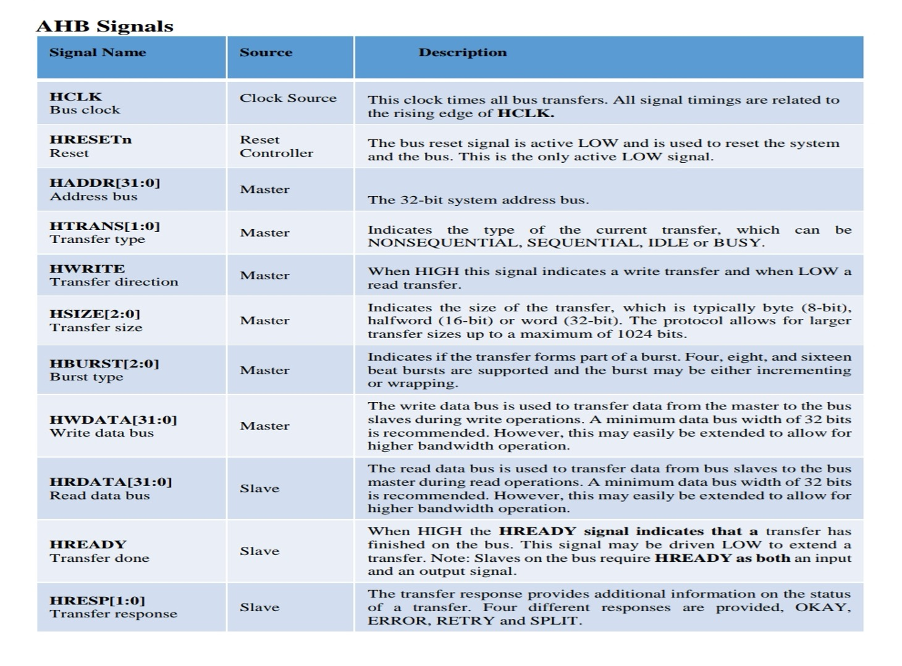
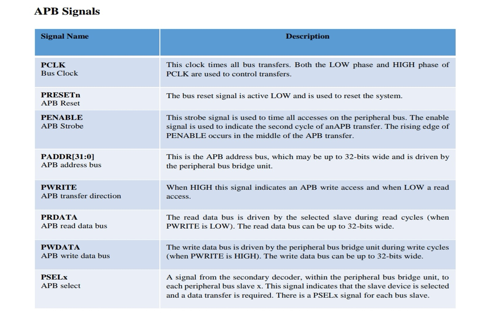
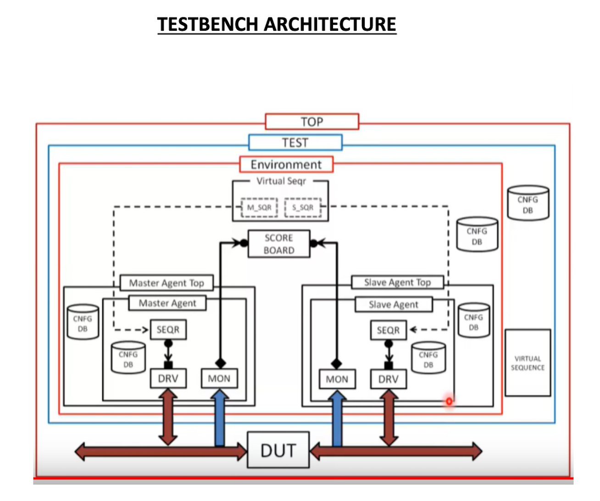

# AHB-to-APB Bridge Verification

A SystemVerilog/UVM project focused on verifying an AMBA AHB-to-APB bridge. The bridge connects a high-performance AHB system bus to lower-speed APB peripherals by translating AHB read and write transfers into corresponding APB transactions.

## AMBA (Advanced Microcontroller Bus Architecture)

The **Advanced Microcontroller Bus Architecture (AMBA)** specification defines an on-chip communications standard for designing high-performance embedded microcontrollers and connecting functional blocks in a System-on-Chip (SoC).

Three distinct buses defined within the AMBA specification are:

| Protocol |         Full name             |
|----------|-------------------------------|
| AHB      | Advanced High-performance Bus |
| AXI      | Advanced eXtensible Interface |
| APB      | Advanced Peripheral Bus       |

## AHB (Advanced High-performance Bus)

The AHB protocol is designed for fast, high-bandwidth data transfers.

- The AMBA AHB is for high-performance, high clock frequency system modules.
- It needs one clock cycle to complete a transfer when no wait states are inserted.
- It supports multiple masters and multiple slaves.
- It supports pipelined operation with separate address and data phases.
- It uses `HTRANS` to indicate the type of the current transfer: NONSEQUENTIAL, SEQUENTIAL, IDLE, or BUSY.

### AHB Signal Descriptions

### AHB Burst Types

`HBURST[2:0]` identifies the burst type.

| `HBURST[2:0]` | Type     | Description                              |
|---------------|----------|------------------------------------------|
| `000`         | `SINGLE` | single transfer                          |
| `001`         | `INCR`   | Incrementing burst of unspecified length |
| `010`         | `WRAP4`  | 4-beat wrapping burst                    |
| `011`         | `INCR4`  | 4-beat incrementing burst                |
| `100`         | `WRAP8`  | 8-beat wrapping burst                    |
| `101`         | `INCR8`  | 8-beat incrementing burst                |
| `110`         | `WRAP16` | 16-beat wrapping burst                   |
| `111`         | `INCR16` | 16-beat incrementing burst               |

## APB (Advanced Peripheral Bus)

The APB protocol is optimized for low-power peripheral devices.

- The AMBA APB is for low-power peripherals.
- It is optimized for minimal power consumption.
- A basic transfer uses two clock cycles: SETUP followed by ENABLE.
- It typically has one master and multiple slaves.
- Its main transfer states are IDLE, SETUP, and ENABLE.

### APB Signal Descriptions

## AHB-to-APB Bridge

An **AHB-to-APB bridge** is an AHB slave, providing an interface between the high-speed AHB and the low-power APB. Read and write transfers on the AHB are converted into equivalent transfers on the APB.

AHB is designed for fast, high-bandwidth transfers, while APB is optimized for low-power peripheral devices. Since APB is not pipelined, wait states are added during transfers when the AHB master must wait for the APB transfer to complete.

## Testbench Architecture

The UVM testbench verifies the bridge using AHB- and APB-side verification components. The environment can generate transactions, drive and monitor bus activity, check expected behavior, and collect functional coverage.

## Tools and Technologies

- **HDL:** SystemVerilog
- **Verification methodology:** UVM
- **Simulator:** Synopsys VCS
